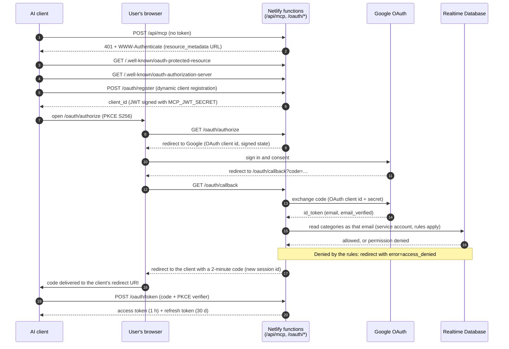
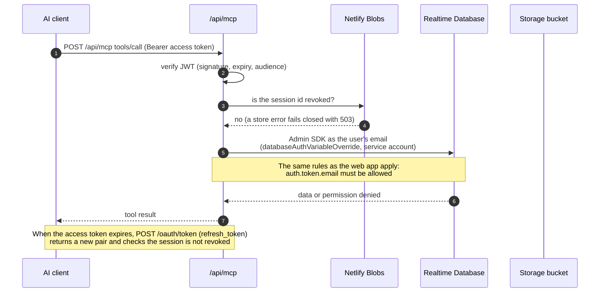
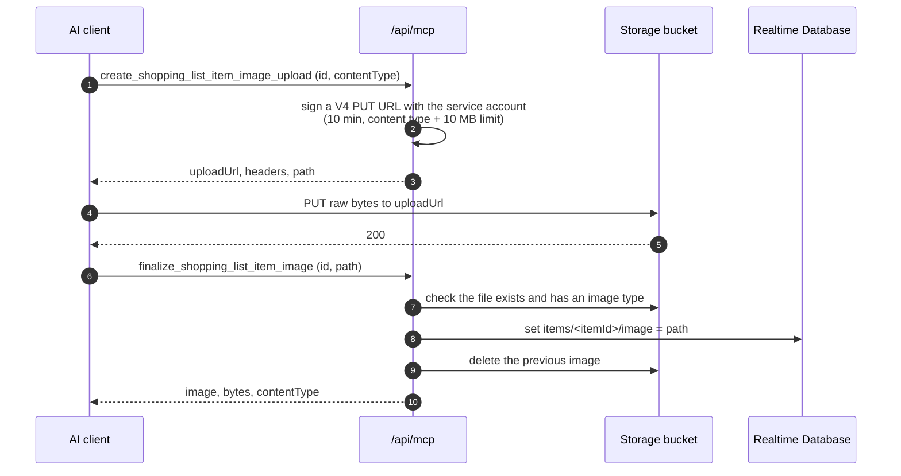

# MCP server (AI agents)

The list can be read and edited by AI agents (Claude, ChatGPT, Cursor, ...) through an [MCP](https://modelcontextprotocol.io) server hosted as a Netlify function at `https://<your-site>/api/mcp`.

Agents sign in with Google, same as the app, and the database rules apply to them as well: only emails allowed by your Firebase rules can access the list.

Tools: `list_shopping_list`, `add_to_shopping_list`, `update_shopping_list_item` (including check / uncheck), `set_shopping_list_item_image`, `create_shopping_list_item_image_upload` + `finalize_shopping_list_item_image`, `remove_shopping_list_item_image`, `remove_from_shopping_list`, `clear_checked_items`, `list_categories`, `create_category`, `update_category`, `delete_category`, `list_suggestions`, `delete_suggestion`.

## How it works

What each piece holds:

| Piece | Holds | Used for |
| --- | --- | --- |
| Google Cloud OAuth client | client id + client secret (`MCP_GOOGLE_CLIENT_ID`, `MCP_GOOGLE_CLIENT_SECRET`) | Signing the user in with Google and getting a verified email |
| `MCP_JWT_SECRET` | HMAC key | Signing the MCP's own tokens (client id, state, code, access, refresh) |
| Firebase service account | `project_id`, `client_email`, `private_key` (`FIREBASE_SERVICE_ACCOUNT`) | Admin SDK access to the Realtime Database and Storage |
| Realtime Database | `list`, `items`, `categories`, rules on `auth.token.email` | Source of truth; rules decide who may read and write |
| Storage bucket | `items/<itemId>#…` image files | Item photos |
| Netlify Blobs | revoked session ids | Revoking tokens |

### Install (connecting an agent)

The agent only needs the MCP URL. Everything else is discovered.



### User request (a tool call)



### Photo upload (full size, bytes never go through the agent)



`set_shopping_list_item_image` is the shortcut for a public image: the function fetches the https URL (up to 4 MB), writes it to Storage with the service account, and updates `items/<itemId>/image`.

## Adding items over REST

Bots can add items without reading the list first: `POST /api/items` (same Bearer token as the MCP) with one item or an array. The status says what happened:

| Status | `code` | Meaning |
| --- | --- | --- |
| 201 | `new` | Unknown item: created and put on the list |
| 201 | `suggestion` | Known suggestion: put on the list |
| 409 | `already_on_list` | Already on the list, still to buy (`listItemId` is returned) |
| 409 | `already_checked` | On the list but checked (`listItemId` is returned, uncheck it to buy again) |
| 400 / 404 | `invalid_input` / `not_found` | Bad input / unknown category |

An array is answered with `207` and `{ "results": [{ "status", "code", ... }] }`, one entry per item in order. Items are processed sequentially, so a duplicate name inside one batch gets a 409.

## Setup

1. In the Google Cloud console (the project behind your Firebase project) create an OAuth client of type *Web application* and add `https://<your-site>/oauth/callback` as an authorized redirect URI.
2. Create a Firebase service account key (Project settings > Service accounts).
3. Set these Netlify environment variables (see `.env.sample`): `MCP_JWT_SECRET`, `MCP_GOOGLE_CLIENT_ID`, `MCP_GOOGLE_CLIENT_SECRET`, `FIREBASE_SERVICE_ACCOUNT`. `VITE_DATABASE_URL` is reused for the database.
4. Add `https://<your-site>/api/mcp` as a custom connector / remote MCP server in your AI client. The client discovers the OAuth endpoints automatically.

Gotchas:
- Netlify caps all environment variables visible to functions at 4 KB combined. Store `FIREBASE_SERVICE_ACCOUNT` as one line with only `project_id`, `client_email` and `private_key`, and remove unused variables (e.g. old `REACT_APP_*`).
- Variables can have a different value per deploy context. Deploy previews may point at a separate (dev) Firebase project, so give that context a service account key from the same project as its `VITE_DATABASE_URL`.
- The service account needs access to that project's Realtime Database (the default `firebase-adminsdk-…` account has it; a custom one needs a suitable role).
- `set_shopping_list_item_image` writes to Firebase Storage with the service account, so that account needs Storage access (the default `firebase-adminsdk-…` account has it). Images are stored as `items/<itemId>#…` like the app does, up to 4 MB from a public https URL.
- Full-size photos: call `create_shopping_list_item_image_upload` (returns a 10-minute signed URL), `PUT` the raw bytes to it with the returned headers (e.g. `curl --upload-file photo.jpg -H 'Content-Type: image/jpeg' -H 'x-goog-content-length-range: 0,10485760' "<uploadUrl>"`), then call `finalize_shopping_list_item_image`. The bytes never pass through the agent's context, up to 10 MB. The same steps are in the tool descriptions and the server `instructions`, so a client needs no instructions of its own; it only needs some way to send the file's bytes (a shell, or a client tool that PUTs a chat attachment).
- Realtime Database rule timestamps (`now < …`) are in milliseconds.

## Logs

The functions write one JSON line per event (`netlify/functions/lib/log.ts`) with `level`, `event` and `ts` plus context, so the Netlify function logs can be filtered by `event`:

| Event | When |
| --- | --- |
| `oauth.register`, `oauth.authorize`, `oauth.signed_in` | A client registers, starts sign-in, completes it |
| `oauth.google_token_exchange_failed` | Google refused the code (the `googleError` field says why, e.g. `redirect_uri_mismatch`, `invalid_client`) |
| `oauth.access_denied` | The database rules rejected the email (the error message says which rule or role) |
| `oauth.token`, `oauth.token_rejected` | Code or refresh grants; `reason` says why one was rejected (PKCE, client id, revoked, expired) |
| `oauth.revoked`, `oauth.revoke_ignored` | Session revocation |
| `mcp.initialize`, `mcp.tool` | A client connects; each tool call with `tool`, `ms`, `ok` and the error message when it failed |
| `mcp.unauthorized`, `mcp.token_revoked` | Rejected requests (`reason`: `no_token`, `invalid_or_expired_token`, `wrong_audience`) |
| `mcp.revocation_check_failed`, `oauth.unhandled_error` | Server errors, with a short stack |

Logs never contain tokens, codes, secrets, signed URLs, request bodies, tool argument values or image data. Emails are masked (`j***@gmail.com`) and tool calls log only the argument names.

### Shipping the logs to Grafana (optional)

With `GRAFANA_LOKI_URL`, `GRAFANA_LOKI_USER` and `GRAFANA_LOKI_TOKEN` set in Netlify, each function also pushes its log lines to Grafana Cloud Loki before it returns (`flushLogs` in `lib/log.ts`). It gives up after 2 seconds and never fails a request. Without the variables nothing is sent.

1. In Grafana Cloud open your stack, then Loki > Details: copy the URL (`https://logs-prod-….grafana.net`) and the user id.
2. Create an access policy token with the `logs:write` scope (Administration > Cloud access policies) and set it as `GRAFANA_LOKI_TOKEN`.
3. Set the three variables in Netlify (the token is a secret). Mind the 4 KB limit on all variables combined.

Streams carry the labels `app="synced-shopping-list"`, `service_name` (`synced-shopping-list-mcp` or `synced-shopping-list-oauth`), `env` (the Netlify deploy context: `production`, `deploy-preview`, ...) and `level`. Everything else is in the JSON line:

```logql
{app="synced-shopping-list", service_name="synced-shopping-list-mcp"} | json | event="mcp.tool" | ok="false"
{app="synced-shopping-list", env="deploy-preview"} | json | event=~"oauth.*"
```

## Tokens and revocation

Tokens are signed JWTs (access 1h, refresh 30d), each tied to a session id. POST a token to `/oauth/revoke` (RFC 7009) to revoke its whole session: the revoked session ids are kept in Netlify Blobs, checked on every MCP call and on refresh (a revocation can take up to about a minute to apply). Rotating `MCP_JWT_SECRET` signs everybody out. The service account is only used to impersonate the signed-in user's email so the rules are enforced.
